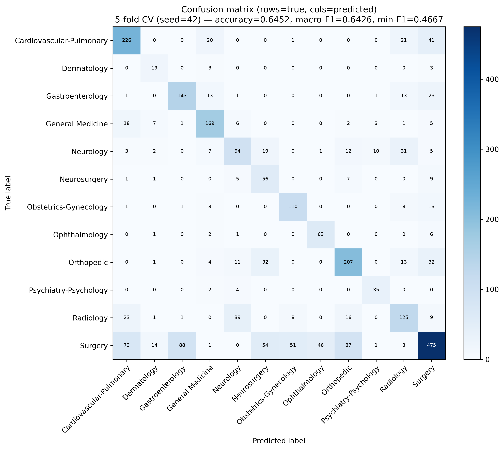

# Short Paper Draft: Natural Language Project 2026

**Group Number**: NUM  
**Authors**: Author 1 (25%), Author 2 (25%), Author 3 (25%), Author 4 (25%)  
**File Target**: NUM.pdf (Max 3 pages)  
**Deliverables**: NUM.pdf, code + data/augmented_cache.json, results.txt  
**Submission Deadline**: October 16th, 2026, 23:59 via Fenix  

---

## 1. Introduction

Clinical documentation generated across hospital encounters ranges from concise procedure titles to multi-page narrative transcriptions. Each record bundles heterogeneous fields (`sample_name`, `description`, `keywords`, `transcription`). Automated categorization into medical specialties enables efficient routing and indexing. However, this task presents severe challenges: extreme class imbalance (a 35.7:1 ratio between Surgery and Dermatology), structural noisiness from broken CSV formatting, and wild field length asymmetry.

**Research Question:** *How does scaling model complexity, from lightweight sparse bag-of-words baselines to frozen dense clinical language models and long-context transformers—trade off against runtime and classification performance under severe class imbalance, and to what extent can data augmentation help the performance of minority classes?*

We evaluate a progressive model hierarchy: starting with fast, lightweight TF-IDF combined with Multinomial Naive Bayes; stepping up to per-field dense representations using frozen `Bio_ClinicalBERT`; and exploring full-note encoding via `Clinical-Longformer`. We show how balancing computational cost with representation power, paired with a two-stage data augmentation pipeline (back-translation followed by embedding-space SMOTE), attempts to solve the class imbalance and establishes robust minority recall.

---

## 2. Data

### 2.1 Data Analysis

We analyze `train.csv` (2,669 cleaned records across 12 specialties) and `test_no_labels.csv` (398 unlabelled records). 

**Table 1 - Training-set class distribution.**

| Specialty | Count | Share | Specialty | Count | Share |
|:---|---:|---:|:---|---:|---:|
| Surgery | 893 | 33.5% | Obstetrics-Gynecology | 136 | 5.1% |
| Cardiovascular-Pulmonary | 309 | 11.6% | Neurosurgery | 79 | 3.0% |
| Orthopedic | 300 | 11.2% | Ophthalmology | 73 | 2.7% |
| Radiology | 222 | 8.3% | Psychiatry-Psychology | 41 | 1.5% |
| General Medicine | 212 | 7.9% | Dermatology | 25 | 0.9% |
| Gastroenterology | 195 | 7.3% | Neurology | 184 | 6.9% |
| **Total** | **2,669** | **100%** | | | |

*Keyword-Label:* Across training records, the first keyword matches the specialty label in ~83% of cases (and ~80% in test). This reveals that the keyword labels is a field that provides really high signal, if present, but is not enough for all of the cases.

*Field Length Asymmetry:* While `sample_name` averages 3.8 words and `description` averages 18.9 words, `transcription` has a median word count of 389 words (median ~651 WordPiece tokens), with **only 38.2% of notes fitting inside standard 512-token transformer windows** (max length 3,753 tokens). This structural mismatch prevents naive sequence concatenation.

### 2.2 Data Augmentation & Experimental Strategy

To systematically isolate the contribution of data augmentation, our model progression evaluates core architectures **both without augmentation** (serving as unaugmented control baselines) **and with augmentation**. 

To combat the 35.7:1 class imbalance, our augmentation pipeline is applied strictly within each CV training partition (never on validation/test sets) across two incremental stages:

- **Stage 1 (Back-Translation):** Minority classes are topped up using round-trip machine translation (EN $\rightarrow$ {es, de, fr} $\rightarrow$ EN) to inject lexical diversity.
- **Stage 2 (Embedding-Space SMOTE):** Minority classes are further expanded by interpolating between real minority feature vectors and their $k=5$ nearest neighbors. All synthetic vectors are L2-renormalized to unit length to preserve hyperspherical embedding geometry.

**Alternative Augmentation Exploration:** We also investigated alternative embedding-space augmentation methods such as embedding Gaussian noise and embedding Mixup. However, these techniques added complexity that was not justified by the negligible changes in the metrics.

**Key Empirical Insight:** Embedding-space augmentation *alone* raises overall accuracy but hurts the per-class F1 floor by generating degenerate clusters. Only by chaining text-level back-translation (which injects true lexical diversity) with embedding-space SMOTE do we achieve a balanced boost in both accuracy and minority class recall.

**Target Size Exploration:** We tested different target sizes for both back-translation ($N_1 \in \{100, 200, 300\}$) and embedding SMOTE ($N_2 \in \{300, 500, 800\}$). Empirical validation showed that $N_1=200$ and $N_2=500$ represents the optimal sweet spot between diversity and representation density.

---

## 3. Models & Architectural Progression

To analyze how different text representations and feature layouts handle clinical text, we implement a progression of models scaling from lightweight sparse bag-of-words classifiers to frozen dense clinical language models and long-context encoders.

### 3.1 Sparse TF-IDF Models
- **Model 1a (Single-Field Baseline):** Applies a TF-IDF vectorizer exclusively to the `description` field with lowercasing and standard English stemming, feeding a Multinomial Naive Bayes classifier using standard learned class priors ($P(c) = N_c / N$).
- **Model 1b (Per-Field Feature Union with Uniform Priors):** Uses independent TF-IDF vectorizers (20,000 maximum features per field) across all four fields (`sample_name`, `description`, `keywords`, `transcription`) combined via a sparse `FeatureUnion` so token identities remain distinct per field. It pairs with Multinomial Naive Bayes configured with uniform class priors (`fit_prior=False`, setting $P(c) = 1/12$ for all classes).
- **Model 1c (Augmented Sparse Baseline):** Extends Model 1b by incorporating text-level back-translation into the training folds, expanding minority classes up to $N_1 = 200$ samples via round-trip translation (English $\rightarrow$ {Spanish, German, French} $\rightarrow$ English).

### 3.2 Frozen Clinical Language Models
- **Model 2a (Joined-Text Frozen BERT):** Encodes concatenated text fields (`sample_name + description + keywords` joined into a single string) using a frozen `emilyalsentzer/Bio_ClinicalBERT` encoder (weights frozen, no gradient updates). It mean-pools non-padding tokens, L2-normalizes the resulting 768-dimensional vector, and trains a downstream `LogisticRegression(class_weight='balanced')` classifier.
- **Model 2b (Joined-Text + Back-Translation):** Model 2a combined with training-fold text-level back-translation (target $N_1 = 200$).
- **Model 2c (Per-Field Frozen BERT):** Encodes `sample_name`, `description`, and `keywords` *independently* through `Bio_ClinicalBERT` (omitting `transcription` due to the 512-token window limit). Each field produces a 768-d vector, and the three vectors are horizontally stacked into a 2,304-dimensional feature matrix (empty fields contribute an all-zeros vector). It feeds into `LogisticRegression(class_weight='balanced')`.
- **Model 2d (Per-Field + Back-Translation):** Model 2c combined with training-fold text-level back-translation (target $N_1 = 200$).
- **Model 2e (Per-Field + Chained BT & Embedding SMOTE):** Combines Model 2c with a two-stage augmentation pipeline executed strictly inside each training fold: text-level back-translation (target $N_1 = 200$) followed by embedding-space SMOTE (interpolating minority feature vectors with their $k=5$ nearest neighbors to expand minority classes to $N_2 = 500$ samples, with synthetic vectors L2-rescaled to unit length). Fed into `LogisticRegression(max_iter=2000, class_weight='balanced')`.

### 3.3 Long-Context Integration
- **Model 3a (Full-Note Clinical-Longformer):** Extends the per-field dense architecture by adding a fourth independent 768-dimensional block encoding the full, un-truncated `transcription` note using `yikuan8/Clinical-Longformer` (4,096-token window utilizing sliding-window and global attention). The four blocks are hstacked into a 3,072-dimensional matrix and paired with the two-stage augmentation pipeline and balanced logistic regression.

---

## 4. Experimental Setup

To ensure rigorous and reproducible evaluation across all model families, our experimental setup defines precise data protocols, cross-validation splits, feature extraction parameters, augmentation safeguards, and classification hyperparameters:

- **Datasets, Splits & Validation Protocol:** All models are evaluated on `train.csv` (cleaned to 2,669 records across 12 specialties). To prevent overfitting and obtain robust variance estimates, all models utilize **5-fold stratified cross-validation** (out-of-fold evaluation). For dense embedding and transformer models, CV results are additionally averaged across **3 random seeds** (42, 1, 7). The unlabelled test set (`test_no_labels.csv`, 398 records) is kept strictly isolated and used solely for generating final submission predictions (`results.txt`).
- **Evaluation Metrics:** Performance is measured using Accuracy, Macro-F1, and Minimum Per-Class F1. Models must satisfy the shared-task graded bars: overall accuracy $> 0.49$ and no per-class F1 below $0.250$.
- **Feature Extraction & Vectorization Parameters:** 
  - *Sparse TF-IDF Models:* Configured with lowercasing, standard English stemming, and up to 20,000 maximum features per field combined via a sparse `FeatureUnion`.
  - *Dense Clinical Embeddings & Long-Context Models:* Uses frozen `emilyalsentzer/Bio_ClinicalBERT` and `yikuan8/Clinical-Longformer`. Encodings are mean-pooled, L2-normalized to unit hypersphere vectors, and cached offline in `.npz` files for deterministic re-runs.
- **Data Augmentation Protocol:** Executed **strictly within each CV training partition** (never leaking into validation or test folds). Back-translation targets minority classes up to $N_1 = 200$ samples using round-trip translation (EN $\rightarrow$ {es, de, fr} $\rightarrow$ EN). Embedding-space SMOTE further expands minority classes to $N_2 = 500$ samples using $k=5$ nearest neighbors, with synthetic vectors L2-rescaled to unit length.
- **Classifier Hyperparameters:** 
  - TF-IDF models use Multinomial Naive Bayes with either learned priors or forced uniform priors ($P(c) = 1/12$).
  - Dense and long-context models feed into `LogisticRegression(max_iter=2000, class_weight='balanced')` to counteract class imbalance during loss optimization.

---

## 5. Results

### 5.1 Benchmark Comparison

**Table 2 - Model benchmark (5-fold CV, 3-seed mean).**

| Model ID | Model Architecture | Text Layout | Augmentation | Accuracy | Macro-F1 | Min Class F1 |
|:---|:---|:---|:---|---:|---:|---:|
| **Model 1a** | MNB (TF-IDF desc) | Concatenated | Learned Priors | 37.60% | 0.1160 | 0.0000 |
| **Model 1b** | MNB (FeatureUnion) | Per-Field | Uniform Priors | 49.79% | 0.2621 | 0.0000 |
| **Model 1c** | MNB (FeatureUnion) | Per-Field | Back-Translation ($N=200$) | 49.90% | 0.4540 | 0.2640 |
| **Model 2a** | Bio_ClinicalBERT | Concatenated | None (No Aug) | 55.00% | 0.5640 | 0.3780 |
| **Model 2b** | Bio_ClinicalBERT | Concatenated | Back-Translation ($N=200$) | 56.80% | 0.5820 | 0.3950 |
| **Model 2c** | Bio_ClinicalBERT | Per-Field | None (No Aug) | 59.20% | 0.6050 | 0.4400 |
| **Model 2d** | Bio_ClinicalBERT | Per-Field | Back-Translation ($N=200$) | 60.63% | 0.6164 | 0.4469 |
| **Model 2e** | **Bio_ClinicalBERT (Recipe 6d)** | **Per-Field** | **BT (200) + SMOTE (500)** | **64.27%** | **0.6397** | **0.4659** |
| **Model 3a** | Clinical-Longformer | Per-Field + Note | BT (200) + SMOTE (500) | 63.89% | 0.6368 | 0.4689 |

### 5.2 Per-Label Performance & Confusion Matrix

**Table 3 - Per-label test/validation metrics for Model 2e (Recipe 6d, seed 42).**

| Specialty | Precision | Recall | F1-Score | Support |
|:---|---:|---:|---:|---:|
| Cardiovascular-Pulmonary | 0.653 | 0.731 | 0.690 | 309 |
| Dermatology | 0.413 | 0.760 | 0.535 | 25 |
| Gastroenterology | 0.611 | 0.733 | 0.667 | 195 |
| General Medicine | 0.754 | 0.797 | 0.775 | 212 |
| Neurology | 0.584 | 0.511 | 0.545 | 184 |
| Neurosurgery | 0.348 | 0.709 | 0.467 | 79 |
| Obstetrics-Gynecology | 0.647 | 0.809 | 0.719 | 136 |
| Ophthalmology | 0.573 | 0.863 | 0.689 | 73 |
| Orthopedic | 0.625 | 0.690 | 0.656 | 300 |
| Psychiatry-Psychology | 0.700 | 0.854 | 0.769 | 41 |
| Radiology | 0.581 | 0.563 | 0.572 | 222 |
| Surgery | 0.765 | 0.532 | 0.627 | 893 |
| **Macro Average** | **0.605** | **0.713** | **0.643** | **2,669** |

Figure 1 illustrates the full 12x12 confusion matrix corresponding to Table 3.

---

## 6. Discussion & Error Analysis

### 6.1 Analysis of Per-Label Results

Examining the per-label metrics and confusion matrix reveals several notable patterns regarding dataset support and inter-specialty boundaries:

- **Support vs. Performance:** Interestingly, raw training support does not strictly dictate F1 performance. While *Surgery* commands the largest support ($N = 893$), its F1 score settles at $0.627$ with a lower recall of $0.532$, which could suggest that its broad procedural scope overlaps extensively with neighboring surgical specialties. Conversely, minority classes with very modest support—such as *Psychiatry-Psychology* ($N = 41$, F1 $0.769$) and *Obstetrics-Gynecology* ($N = 136$, F1 $0.719$)—achieve high metrics, which may indicate that their clinical vocabulary is exceptionally distinct and well-separated in the embedding space.
- **Lower-Metric Confusion Patterns:** The classes exhibiting the lowest F1 scores are *Neurosurgery* (F1 $0.467$, Precision $0.348$), *Neurology* (F1 $0.545$), and *Radiology* (F1 $0.572$). The low precision for *Neurosurgery* appears to stem from procedural overlaps, where spinal cases from *Orthopedic* surgery ($32$ cases) and general *Surgery* ($54$ cases) are predicted as *Neurosurgery*. Similarly, *Radiology* appears to function as a semantic crossroads, leaking into *Neurology* ($39$ cases) and *Cardiovascular-Pulmonary* ($23$ cases), which may reflect the cross-system nature of imaging descriptions.

### 6.2 Connection to Data Analysis (§2)

These confusion patterns directly align with our findings from the Data Analysis section. Because short `description` fields often summarize procedures through shared instrumentation vocabulary (such as "decompressive laminectomy and instrumented fusion" appearing across both Neurosurgery and Orthopedic surgery) without explicitly naming the underlying organ system, linear classifiers may struggle to disambiguate adjacent medical specialties using concise metadata alone.

### 6.3 Error Analysis & Inter-Specialty Overlap

Analysis of out-of-fold misclassifications shows that errors are not distributed uniformly across the board; rather, they cluster tightly into procedurally related groups. Surgical subspecialties share dense instrumentation and procedural terminology, leading the model to distribute *Surgery* errors across *Gastroenterology* ($88$ cases), *Orthopedic* ($87$ cases), and *Cardiovascular-Pulmonary* ($73$ cases). This confirms that feature representations remain sensitive to shared procedural verbs when anatomical signposts are sparse.

---

## 7. Future Work

Building upon our frozen dense embedding and two-stage augmentation pipeline, several promising directions remain for future work:

1. **End-to-End Fine-Tuning:** While our frozen feature-extraction approach offered an exceptionally fast iteration cycle and robust performance, full end-to-end fine-tuning of `Bio_ClinicalBERT` directly on the clinical corpus is an obvious next step. Because full fine-tuning demands substantial computational resources and training time, it was beyond the scope of this project, but it would allow the model to adapt its lower-level attention weights directly to medical terminology.
2. **Hierarchical Classification:** Given that our confusion matrix demonstrated heavy error clustering among surgical subspecialties (e.g., Neurosurgery and Orthopedic surgery), implementing a hierarchical classification structure—such as first predicting broad clinical categories (surgical vs. medical vs. imaging) and then classifying subspecialties—could resolve fine-grained ambiguities.
3. **Generative LLM Data Augmentation:** Beyond text-level back-translation and embedding SMOTE, leveraging instruction-tuned medical language models to generate synthetic patient narratives for extremely rare minority classes (such as Dermatology) could provide richer lexical diversity.

---

## References & LLM Declaration

[TODO: Complete final references]

- **References:** `emilyalsentzer/Bio_ClinicalBERT` (Alsentzer et al., 2019); scikit-learn (Pedregosa et al., 2011); sentence-transformers (Reimers & Gurevych, 2019).
- **LLM Declaration:** Large Language Models (LLMs) were used solely as a coding and drafting assistant under human supervision to implement data loaders, augmentation scripts, and refine technical prose.

---

## Appendix A: Supplementary Tables

[TODO: Add supplementary tables if needed]

*Additional validation breakdown and test prediction distributions are logged in `EXPERIMENTS.md` and `results.txt` (398 lines, order matching `test_no_labels.csv`).*
